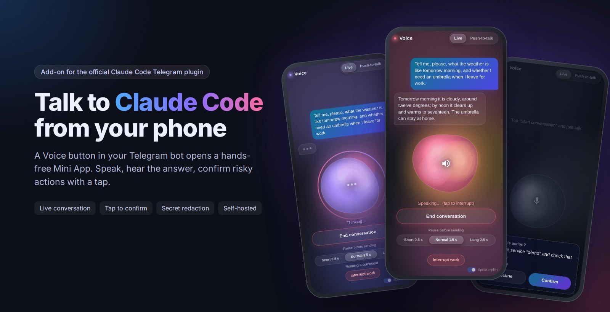
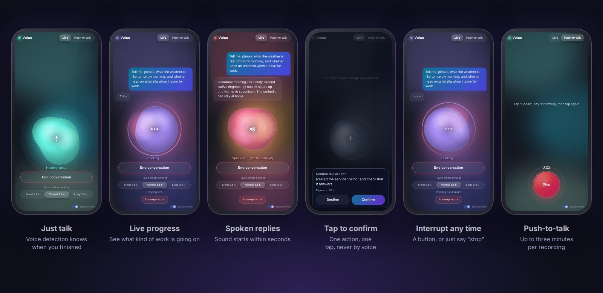

<h1 align="center">Claude Telegram Voice Channel</h1>

<p align="center"><b>Talk to Claude Code by voice, right from Telegram.</b><br>
A voice add-on for the official Telegram plugin for Claude Code.</p>

<p align="center">
  
  
  
  
</p>

<p align="center">
  <a href="#what-it-does">What it does</a> ·
  <a href="#what-you-can-do-with-it">What you can do</a> ·
  <a href="#quick-start">Quick start</a> ·
  <a href="#safe-by-design">Safety</a> ·
  <a href="#install">Install</a> ·
  <a href="CHANGELOG.md">What's new</a>
</p>

<p align="center"></p>

## What it does

The official Telegram plugin lets you message a Claude Code session running on your computer or server. This add-on gives the same bot a **Voice** button. It opens a small app inside Telegram: you speak, Claude answers out loud and on screen, and a text copy of the conversation lands in your chat.

Your words go into the same Claude Code session, with all its memory, files and tools. Nothing about the plugin is replaced or changed: install and pair the plugin first, then add this module. Speech recognition and synthesis go through [OpenRouter](https://openrouter.ai) with your own key; a spoken turn typically costs well under a cent.

## What you can do with it

- **Work with Claude Code hands-free.** Ask questions, give tasks and hear the results while you walk, cook or are away from the keyboard.
- **Have a natural back-and-forth.** Just talk: the app notices when you pause, sends your phrase, reads the answer aloud and listens again. The first sentence of an answer plays within a few seconds, while the rest is still being prepared.
- **Stop Claude mid-task.** Changed your mind or misspoke? Press **Interrupt work**, or start your next phrase with "stop", and Claude drops what it was doing and listens to what you say next.
- **Approve risky actions with one tap.** When Claude wants to push, deploy or restart something, you get a card with the exact action and **Confirm** / **Decline**. Saying "yes" out loud never counts.
- **See what Claude is doing** while it works: reading files, running a command, searching, and whether helper agents are still busy in the background after Claude itself has gone quiet.
- **Send ordinary Telegram voice notes.** Claude transcribes them and treats them as your message.
- **Not lose a word when the session restarts.** What you said in the meantime is delivered when it comes back.
- **Get warned in Telegram** when the session needs a new login, hits its usage limit or is nearly out of context.
- **Keep secrets out of speech and chat.** Keys and tokens are replaced with "[redacted]" before a reply is spoken, shown or copied.

<p align="center"></p>

## What it sounds like

> **You:** "Run the test suite and tell me what failed."
>
> **Claude** *(out loud, a minute later)*: "Two tests failed, both in the payment module: the refund amount is rounded the wrong way. Want me to fix it?"
>
> **You:** "Yes, fix it and push."
>
> **Voice app:** a card appears: *Push branch fix-refund-rounding to origin.* **Confirm** / **Decline**. You tap **Confirm**, Claude pushes.

## Safe by design

A microphone can be fooled: by someone nearby, a video, a phone call or a recognition mistake. So voice is treated as untrusted from the start.

- **Talking is free, acting is not.** By voice alone Claude may answer, read and make local, reversible edits. Pushing, deploying, deleting or touching secrets needs a typed confirmation or a tap on the confirmation card. A spoken "yes" never counts.
- **Only you get in.** Every request is signed by Telegram, and exactly one Telegram account is allowed.
- **Locked-down services and a kill switch.** The voice server runs sandboxed without access to your home directory, and one command stops all voice input instantly.

Full details are in [Security model](#security-model) and [SECURITY.md](SECURITY.md).

## Quick start

1. Have Claude Code with the official Telegram plugin installed and paired with your bot.
2. Clone this repository on the same machine and run `sudo bash deploy.sh`.
3. Put your Telegram user id and your OpenRouter key into `/root/.voice/env`, then run `sudo bash deploy.sh` again.
4. Restart your Claude Code session with the voice channel (`bash restart_main_session.sh`).
5. Open your bot in Telegram and press **Voice**.

The step-by-step version is in [Install](#install).

---

# Documentation

## Features in detail

- **Live conversation.** Tap once and just talk. A voice activity detector running in the page decides when you have finished, sends the phrase, plays the answer and listens again. You can tap the orb to interrupt a spoken answer.
- **Push-to-talk.** Prefer a button? Switch the mode: press to record, press to send. One recording can be up to three minutes.
- **Interrupt work.** While Claude is working or speaking, an **Interrupt work** button is shown. It stops the speech and presses Escape in Claude's terminal, which ends the current turn. Starting a phrase with "stop" (or the Russian "стоп" / "остановись") does the same, and the rest of the phrase reaches Claude as your next message: "Stop, I meant the other server." Escape is sent only while Claude is actually busy and never twice within three seconds.
- **Answers that start quickly.** A reply is spoken in parts: the first sentence is synthesized first and plays within a few seconds, and each next part is downloaded while the previous one plays. Until the sound starts the app shows **Loading…**, not **Speaking**.
- **Tap to confirm risky actions.** When Claude needs your approval, it shows one action as a card with **Confirm** and **Decline**. A tap counts as a typed confirmation for that action only. Saying "yes" never does.
- **Live progress.** While Claude works, a small line says what kind of thing it is doing ("Reading files", "Running a command", "Searching"). Only the kind is shown, never file names or commands. When Claude hands work to helper agents that keep running in the background, the line says so ("A helper is working in the background", "Helper: running a command") until they finish.
- **Telegram voice notes.** Send a voice note to the bot and Claude can read it: it is transcribed with the same speech service.
- **How it was said (experimental).** The speech recognizer can add a short hint about the delivery from a fixed list (unsure, joking, irritated, whispering, another voice, several voices, background media, cut off). Claude gets it as a hint that may be wrong, the app shows it in small print under your words, and a hint that the words may not be yours sends Claude to its rule for media and other speakers. Voice notes carry the same hints after their transcript. In our tests the default recognition model never added such hints; `google/gemini-3.5-flash` did (see `VOICE_STT_MODEL` under [Configuration](#configuration)).
- **Secret redaction.** Anything that looks like a key, token or private key is replaced with "[redacted]" before a reply is spoken, shown or copied to Telegram.
- **Replay after a restart.** Phrases you said while the session was restarting are handed to it when it comes back (for three minutes by default), marked as missed.
- **Session watchdog (optional).** A small timer messages you in Telegram when the session needs `/login`, hit its usage limit, has a billing problem, is gone, or is nearly out of context.
- **Text copy in Telegram.** The conversation is mirrored into your chat as text. You can turn that off.

## How it works

```
Telegram Mini App (your phone)               Claude Code session
   | your voice (PCM audio)                      ^
   v                                             | incoming message
voice-web (Python, 127.0.0.1) ---- queue ---- channel server (Bun, started by Claude Code)
   |   speech to text / text to speech            voice_reply, voice_confirm, voice_transcribe tools
   |   (OpenRouter)
   ^
Cloudflare quick tunnel -> public https address -> the bot's menu button
```

1. The page records your voice and sends it to `voice-web`, a small Python server on your machine.
2. `voice-web` turns the audio into text with a speech model and queues the text.
3. A tiny MCP "channel" server, started by Claude Code itself, hands the text to your session as an incoming message.
4. Claude answers with the `voice_reply` tool. `voice-web` turns the answer into speech, the page plays it, and the text is copied to your chat.
5. A free Cloudflare quick tunnel makes the page reachable from Telegram. No Cloudflare account is needed. A script sets the bot's menu button to the tunnel's address.

## Security model

You are letting a microphone give instructions to a machine, so the design assumes the microphone can be fooled. The short version (details in [SECURITY.md](SECURITY.md)):

- **Voice is untrusted.** The speaker is not authenticated: it could be someone nearby, a video, a call or a recognition mistake. Claude is told so. By voice alone it may talk, answer, do read-only work and make local, reversible changes in git repositories.
- **Everything else needs a typed confirmation** in Telegram or the terminal: pushing, deploying, restarting services, deleting data, spending money, installing software, changing settings or permissions, anything involving secrets. A spoken "yes" never counts. A tap on **Confirm** in the app does, for that one action, if you opened the app within the last hour.
- **This is an instruction to the model, not a wall.** The permissions of your Claude Code session still decide what it can do. Keep them tight.
- **Only you can use it.** Every request carries data signed by Telegram. The server accepts exactly one Telegram user id and refuses everything if none is set.
- **Kill switch.** `touch /var/lib/voice/DISABLED` stops all voice input at once, no restart needed. Delete the file to resume.
- **Sandboxed services.** `voice-web` and the tunnel run as throw-away unprivileged users with no capabilities, a read-only filesystem, no access to `/root` or `/home`, and no route to private networks.
- **Privacy routing.** With OpenRouter, every request asks for providers that do not store or train on your data, and speech recognition also asks for zero-data-retention endpoints. Your audio still leaves the machine: do not use this for anything you would not send to a speech service.
- **Little is stored.** Reply audio is kept for one hour, the log of what was said for seven days.

## Requirements

- A Linux machine with systemd and root access to install. The code goes to `/opt/voice`, the configuration to `/root/.voice`, the state to `/var/lib/voice`. These are defaults; the services themselves do not run as root.
- Python 3.12 (standard library only), `curl` and `rsync`.
- [Bun](https://bun.sh), which runs the channel server.
- [cloudflared](https://developers.cloudflare.com/cloudflare-one/connections/connect-networks/downloads/) for the tunnel.
- `tmux`, if you want to use the session restart helper, and for **Interrupt work**: the interrupt is an Escape key sent to the tmux pane the session runs in.
- Claude Code with channels support and the official Telegram plugin (`telegram@claude-plugins-official`) installed, paired and working. This module is an add-on to it and does nothing on its own. This project reuses that plugin's bot: it reads the bot token from the plugin's `.env` file and adds a menu button to the same bot.
- A Telegram bot (the one of that plugin) and your numeric Telegram user id (message `@userinfobot` to find it).
- An [OpenRouter](https://openrouter.ai) API key.

`deploy.sh` downloads about 13 MB of browser libraries for Live mode once (checked against `web/vendor.lock`). The page then serves them itself and loads nothing from third-party servers except Telegram's own script.

## Install

1. Get the code on the machine and run the installer as root:

   ```
   git clone https://github.com/ThaliesLein/claude-telegram-voice-channel.git
   cd claude-telegram-voice-channel
   sudo bash deploy.sh
   ```

   It creates `/root/.voice/` with a settings file (`env`, copied from [`env.example`](env.example)), a secret for the internal API and an empty glossary, copies the code to `/opt/voice`, builds the channel server from its locked dependencies, installs the sandboxed services and starts them.

2. Open `/root/.voice/env` and fill in at least:

   - `VOICE_ALLOWED_USER`: your numeric Telegram user id. Nobody can use the page until this is set.
   - `OPENROUTER_API_KEY`: your key. Without one the server runs in a test mode with no recognition and no speech.
   - `VOICE_LANG`: the language you speak, for example `en-US` or `de-DE`.
   - `CLAUDE_SESSION_ID`: the id of the Claude Code session to attach to (used by the restart helper).

3. Run the installer again so that the services pick the settings up and the bot gets a fresh menu button:

   ```
   sudo bash deploy.sh
   ```

4. Restart your Claude Code session with the voice channel attached. For a session that runs in tmux the helper does it for you:

   ```
   bash restart_main_session.sh
   tmux attach -t claude        # confirm the development-channel prompt, then Ctrl-b d
   ```

   The helper resumes the session with the Telegram channel and the voice channel, adds the progress hooks, and checks that both came up. Use `--no-voice` to get a session without voice back, and for anything unattended (a reboot hook), because nobody is there to confirm the prompt.

   If you start Claude Code yourself, pass these options: `claude --mcp-config /root/.voice/mcp.json --dangerously-load-development-channels server:voice`. Do not add the `voice` server to Claude Code's own settings files.

5. Open your bot in Telegram and press the **Voice** button next to the message box.

Running `deploy.sh` again is safe: it updates the code, adds settings that are new without touching yours, restarts `voice-web`, and restarts the tunnel only if something about it changed (a tunnel restart changes the public address). If the new version does not come up, it puts the previous one back. See [`CLAUDE.md`](CLAUDE.md) for the details, including how to go back to an older version by hand.

## Configuration

All settings live in `/root/.voice/env`. [`env.example`](env.example) lists every key with a comment and is the reference. After editing run `sudo systemctl restart voice-web`. Changing the menu text, the chat or the port needs `deploy.sh` instead, because the tunnel reads its own reduced copy of the file.

| Setting | What it does |
|---|---|
| `VOICE_ALLOWED_USER` | The one Telegram user who may use the page (required). |
| `OPENROUTER_API_KEY` | Key for speech recognition and speech synthesis through OpenRouter. |
| `VOICE_LANG` | Language you speak and hear, as a BCP-47 code such as `en-US`. Used for recognition and speech. |
| `VOICE_TTS_OR_VOICE` | Voice for OpenRouter speech (alloy, ash, ballad, coral, echo, fable, nova, onyx, sage, shimmer, verse, marin or cedar). |
| `VOICE_STT_MODEL`, `VOICE_TTS_MODEL` | Models for recognition and speech (defaults `google/gemini-3.5-flash-lite` and `openai/gpt-audio-mini`). With `VOICE_STT_MODEL=google/gemini-3.5-flash` the recognizer also adds the "how it was said" hints, at the price of about 2 to 4 s instead of about 1.5 s per phrase and roughly 15 to 25 times the recognition cost (measured on short Russian phrases). |
| `VOICE_USER_NAME`, `VOICE_ASSISTANT_GENDER` | Optional. How Claude's instructions refer to you, and whether its replies are spoken in a female or male voice (matters for languages with grammatical gender). |
| `VOICE_MENU_TEXT` | Label of the bot's menu button. |
| `VOICE_MIRROR_TG` | Set to `0` to stop copying the conversation to your Telegram chat. |
| `VOICE_REPLAY_SEC`, `VOICE_CONFIRM_TTL`, `VOICE_CONFIRM_MAX_AGE` | Replay window after a restart (180 s, `0` = off), how long a confirmation card waits (90 s), how fresh the login must be to answer one (1 hour). |
| `VOICE_LIVE_IDLE_SEC`, `VOICE_LIVE_HIDDEN_SEC` | Live mode stops after this long without a tap (15 min) or with the app out of sight (60 s). |
| `VOICE_UTT_PER_MINUTE`, `VOICE_UTT_PER_HOUR`, `VOICE_AUDIO_TTL`, `VOICE_INBOX_DAYS`, `VOICE_AUTH_MAX_AGE`, `VOICE_OR_ZDR_STT`, `VOICE_CSP` | Rate, retention and security limits. The defaults suit most installations. |
| `VOICE_AUTH_WATCH` | Set to `1` to switch on the session watchdog. |

**Glossary.** If names or technical terms are often misrecognized, list them in `/root/.voice/glossary.txt`, one per line, spelled the way you want them. Restart `voice-web` after editing.

## Using it

- Press **Voice** in the bot's chat and pick **Live** (default) or **Push-to-talk** at the top. The page remembers your choice.
- **Live:** tap **Start conversation** and talk. The orb shows what is happening: listening, hearing you, sending, thinking, loading (while the first words of a reply are on their way), speaking. **Pause before sending** sets how long a silence ends your phrase: 0.8 s, 1.5 s (default) or 2.5 s.
- **Push-to-talk:** press the big button, speak, press again.
- **Interrupt work** (shown while Claude is working or a reply plays) stops the speech and presses Escape in Claude's terminal; saying "stop" (Russian "стоп" or "остановись") at the very start of a phrase does the same, and whatever follows is sent as usual. Tapping the orb cuts off the speech. **End conversation** closes Live. The small **Speak replies** switch in the corner off gives you text only.
- The page speaks Russian if your Telegram app is set to Russian and English otherwise.

Live mode needs the screen to stay on: it asks the phone not to lock, pauses when you switch away, stops after a minute out of sight and after 15 minutes without a tap, so a forgotten phone cannot keep the microphone open. While an answer is spoken the microphone is ignored (so the phone does not hear itself); you interrupt by tapping.

## Costs

Measured with the default models: speech recognition takes about 1.3 s and speech synthesis about 1.3 s per phrase, and a full exchange costs well under one cent. A Telegram voice note costs about $0.001 per minute. The rest of the waiting is Claude thinking. Each Live phrase is its own recognition request, so a long Live conversation costs a little more than the same words in Push-to-talk.

## Tests

Run them one at a time (the browser-based ones use a CPU core for the speech model):

```
python3 tests/test_audio.py          # server logic, redaction, limits, retention (no network, no keys)
python3 tests/test_session.py        # session helper, progress hook, watchdog
python3 tests/test_deploy.py         # deploy scripts, unit hardening, migration (about 2 minutes)
E2E_SKIP_PROD=1 python3 tests/e2e_fake.py   # end to end against throwaway instances
```

`tests/e2e_browser.py` drives headless Chrome against the page and uses real speech recognition and synthesis (a few cents). `tests/screenshots.py OUT_DIR` takes screenshots of the key states (`SHOT_LANG=ru` for the Russian UI), and with `SHOT_DOCS=docs/screenshots` it also writes the smaller copies used in this README; the framed images at the top of this page are rendered from them by `docs/frames/hero.html` and `docs/frames/gallery.html` (open in Chrome headless at 1600 px wide and take a screenshot). After a deploy, `python3 tests/check_deployed.py` checks the installed units. Developer notes with the full specification are in [`CLAUDE.md`](CLAUDE.md).

## Troubleshooting

- **The Speak button does nothing, or "no microphone access".** Allow Telegram to use the microphone in your phone's settings.
- **My words are recognized but no answer comes.** The Claude Code session is not running, or was started without the voice channel. Restart it with `restart_main_session.sh`.
- **The page does not open, or says "Network error".** Check `systemctl status voice-web voice-tunnel` and `journalctl -u voice-web -u voice-tunnel`. A restarted tunnel has a new address: close the page and open it again from the menu button.
- **"Error: forbidden".** The page was opened more than 6 hours ago, your Telegram id is not `VOICE_ALLOWED_USER`, or the bot token belongs to a different bot. Reopen the page from the menu.
- **Live mode shows "basic mode".** The speech detector could not be loaded; run `deploy.sh` again. Live still works with a simpler volume-based detector.
- **Text but no sound.** Check that **Speak replies** is on, the phone is not muted, and that a speech key is set.

More cases are listed in the developer notes.

## Limitations

- **The tunnel address changes** whenever the tunnel restarts (quick tunnels have no guarantee). The menu button is updated automatically, but a page that is already open must be reopened.
- **Development channels flag.** Claude Code asks you to confirm `--dangerously-load-development-channels` on every start, so the first start needs a person at the keyboard.
- **One user, one session.** Exactly one Telegram user can use it, and it talks to one Claude Code session.
- **The screen has to stay on** in Live mode. It cannot listen with the phone locked.
- **Half-duplex.** While an answer is spoken the microphone is paused, so you stop a spoken answer by tapping (the orb or **Interrupt work**), not by voice. Saying "stop" works while Claude is working.
- **Interrupt needs tmux.** If your Claude Code session does not run inside tmux, **Interrupt work** still stops the speech in the app but cannot stop Claude's turn.
- **Your audio goes to a third-party speech service,** and Cloudflare can technically see the traffic that passes through the tunnel.
- Recording is limited to three minutes and 6 MB per phrase. The queue is kept in memory.

## License

[MIT](LICENSE). Third-party components are listed in [THIRD_PARTY_NOTICES.md](THIRD_PARTY_NOTICES.md). To report a security problem, see [SECURITY.md](SECURITY.md). What changed between versions is in [CHANGELOG.md](CHANGELOG.md).
